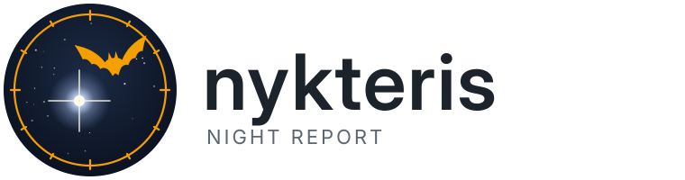
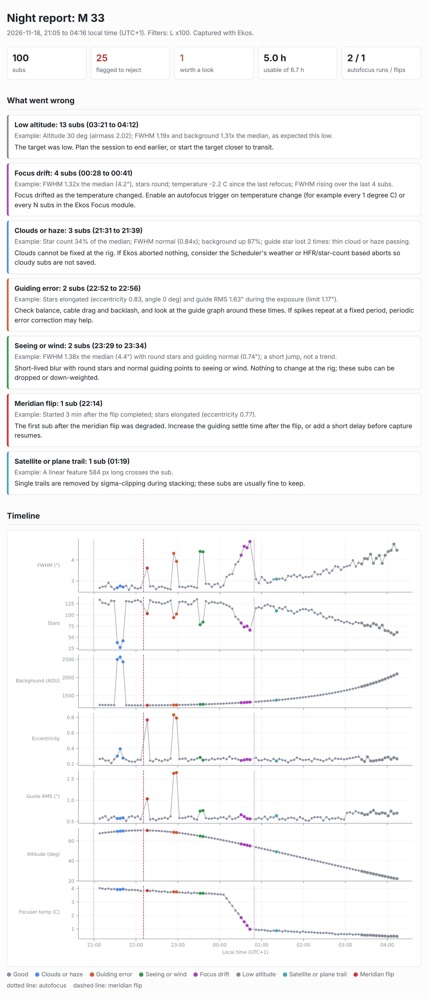

<p align="center">
  <picture>
    <source media="(prefers-color-scheme: dark)" srcset="docs/logo/nykteris-logo-dark.svg">
    
  </picture>
</p>

# Nykteris

A night report for astrophotography sessions captured with Ekos/KStars or N.I.N.A. Point it at a night's lights
folder (FITS or XISF). It picks up what the capture software recorded next to them: the Ekos `.analyze` file, or
N.I.N.A.'s Session Metadata files and autofocus reports, plus the guide log (PHD2 or the Ekos internal guider). It
writes one HTML page that flags bad subs and gives a likely cause for each: clouds, guiding, seeing, focus drift,
low altitude, trails or the meridian flip. It runs on Linux, macOS and Windows.



*The example above is the synthetic test night that ships with Nykteris (`nykteris synth`), not a real sky.*

It does not stack, weight or delete anything. Culling tools already exist (Siril, ASTAP, PixInsight); Nykteris is
about explaining *why* subs went bad, using what Ekos already records.

## Install

Python 3.10 or newer, on Linux, macOS or Windows.

```sh
pipx install "nykteris[xisf]"
```

Until the first release is on PyPI, install from GitHub instead:

```sh
pipx install "nykteris[xisf] @ git+https://github.com/xenotheles/nykteris-night-report"
# or, from a clone:
pip install -e ".[test,xisf]"
```

No `pipx`? `python -m pip install --user pipx` and `python -m pipx ensurepath`, then open a new terminal.

The `xisf` extra adds LZ4 and Zstandard for compressed XISF files. Uncompressed and zlib-compressed XISF work without it.

## Use

```sh
nykteris report ~/Pictures/M_33/Light
```

By default it looks for `*.analyze` and `guide_log-*.txt` / `PHD2_GuideLog*.txt` next to the lights folder and up
to two levels above it. Name them explicitly when they live elsewhere:

```sh
nykteris report ~/Pictures/M_33/Light \
    --analyze ~/.local/share/kstars/analyze/ekos-2026-11-18T20-45-57.analyze \
    --guide-log ~/.local/share/kstars/guidelogs/guide_log-2026-11-18T20-48-27.txt \
    -o ~/reports/2026-11-18.html
```

Outputs, next to the report:

- `<name>.html`: the report (self-contained, open in any browser)
- `<name>.csv`: every sub with its metrics, verdict and causes
- `<name>-rejects.txt`: rejected subs, one per line with the main cause

`--move-rejects` moves rejected subs into a `rejected/` folder beside them. Nothing is ever deleted.
Measurements are cached in `.nykteris-cache.json`, so a rerun with different thresholds is fast.

### N.I.N.A.

```powershell
nykteris report "C:\Users\me\Documents\N.I.N.A\2026-11-18\LIGHT" `
    --guide-log "C:\Users\me\Documents\PHD2\PHD2_GuideLog_2026-11-18_204827.txt" `
    --af-reports "$env:LOCALAPPDATA\NINA\AutoFocus"
```

What N.I.N.A. gives Nykteris, from most to least useful:

- **Image headers** (always): `DATE-OBS` and `DATE-LOC` (so the local time offset is known), `PIERSIDE`, `CENTALT`,
  `AIRMASS`, `FOCPOS`/`FOCTEMP`, `XPIXSZ` and `FOCALLEN`. This alone covers clouds, seeing, focus, altitude,
  trails and flips.
- **Session Metadata plugin** (recommended): `ImageMetaData.json` or `.csv` next to the images adds the guiding
  RMS per sub, N.I.N.A.'s own HFR and star count, and the focuser temperature. Without a guide log, guiding faults
  can then still be told apart from flexure. Found automatically in the lights folder.
- **Autofocus reports**: `%LOCALAPPDATA%\NINA\AutoFocus\*.json` mark when focus was reset and at what temperature.
  Point `--af-reports` at the folder; reports outside the night are ignored.
- **PHD2 guide log**: per-exposure RMS, peak error and lost-star events. Usually in `Documents\PHD2`.

N.I.N.A. does not keep a session event log like Ekos' `.analyze`, so meridian flips are detected from the pier side
changing between subs.

### Ekos

Where Ekos keeps its files on Linux (StellarMate and Astroberry are the same):

| File | Location |
|---|---|
| `.analyze` session | `~/.local/share/kstars/analyze/` |
| Internal guider log | `~/.local/share/kstars/guidelogs/` (enable "Save guide log" in the Guide options) |
| PHD2 guide log | `~/PHD2/` |

## What it measures and how it decides

Every sub is measured with [sep](https://github.com/kbarbary/sep): star count, FWHM (twice the half-flux radius),
eccentricity and how consistent the elongation angle is, background level and noise, and the longest line-like
object. Each sub is compared with the median of its group (same filter, exposure and binning).

The capture software's own records add context for each exposure window: guide RMS during the exposure, guide star
losses, mount altitude and pier side, focuser temperature, autofocus runs and meridian flips. Ekos' own HFR per sub
(or N.I.N.A.'s) is shown next to the Nykteris value as a cross-check. With nothing but the images, the report falls
back to their headers (altitude computed from coordinates, site and time; flips from `PIERSIDE`; focus from
`FOCUSPOS`/`FOCPOS` and `FOCUSTEM`/`FOCTEMP`).

| Cause | Rule (defaults) |
|---|---|
| Meridian flip | Sub degraded in any way and started within 10 min after a completed flip, or first sub on a new pier side |
| Low altitude | Blurred, starved or bright sub below 30 deg, where the airmass explains the blur (FWHM ~ airmass^0.6) |
| Clouds or haze | Star count below 60% of the median while FWHM stays normal; higher confidence with background up or guide star lost |
| Guiding error | Elongated stars with a consistent angle plus guide RMS above 1.5" or 2x the night's median |
| Elongation | Elongated stars with normal guiding: flexure, wind, a loose focuser |
| Focus drift | FWHM above 1.25x the median with round stars, and the temperature changed by 1 C since the last refocus or FWHM rose steadily over 3+ subs |
| Seeing or wind | FWHM above 1.25x with round stars and normal guiding, without a focus pattern |
| Trail | A detected object at least 40 px long with an axis ratio of 6 or more (verdict "check", not "reject") |

Eccentricity is only judged when FWHM is at least 2 px. Undersampled stars look elongated on perfectly good nights,
which is the most common complaint about existing culling tools.

### Thresholds

All thresholds are educated guesses until they have been checked against real nights. Print the defaults, edit,
and pass the file back:

```sh
nykteris thresholds > my-rig.toml
nykteris report ~/Pictures/M_33/Light --config my-rig.toml
```

## Testing without a sky

`nykteris synth OUTDIR` writes a synthetic Ekos night: 100 FITS lights with the INDI header set, a matching
`.analyze` file and an internal-guider guide log on one timeline. `--flavor nina` writes the same night the way
N.I.N.A. would: XISF lights with N.I.N.A.'s keywords, Session Metadata CSV and JSON, autofocus reports and a PHD2
guide log. Both have with faults injected on purpose (cloud passage,
guiding spike, seeing jump, focus drift with falling temperature, meridian flip, satellite trail, target sinking low).
`truth.json` labels every sub, and the tests check that the report finds each fault.

```sh
nykteris synth /tmp/fake-night
nykteris report /tmp/fake-night/Light/L

nykteris synth /tmp/fake-nina --flavor nina
nykteris report /tmp/fake-nina/2026-11-18/LIGHT
pytest
```

The synthetic data validates logic and file handling, not thresholds. Gaussian stars and simple noise are much
tidier than a real sky.

## File formats

Pinned from the KStars and INDI sources:

- `.analyze` (KStars `ekos/analyze/analyze.cpp`): `AnalyzeStartTime,<local time>,<tz>`, then one event per line,
  `<Event>,<seconds since start>,...`. Used: `CaptureComplete`, `GuideStats`, `MountCoords`, `Temperature`,
  `AutofocusStarting/Complete/Aborted`, `MeridianFlipState`, `GuideState`. Unknown events are ignored.
- Guide log (KStars `ekos/guide/internalguide/guidelog.cpp`, PHD2 log format 2.5): sections from `Guiding Begins at`
  to `Guiding Ends at`, local time, distances in guide camera pixels converted with the section's pixel scale.
- N.I.N.A. headers (`NINA.Image/FileFormat/XISF/XISFHeader.cs` and its tests): the same keys in FITS and in XISF
  `<FITSKeyword>` elements. `DATE-OBS`/`DATE-LOC` with seven fractional digits, `IMAGETYP = 'LIGHT'`, `XPIXSZ`
  already includes binning, `PIERSIDE = 'East'/'West'`.
- XISF 1.0: planar little-endian pixel data in an attachment block, optionally zlib, LZ4 or Zstandard compressed
  with byte shuffling.
- Session Metadata plugin (`SessionMetaDataWatcher.cs`): `ImageMetaData.csv`/`.json`, one record per image. Times
  from `ExposureStartUTC`; `GuidingRMSArcSec` is 0 when no guiding was recorded and is then ignored.
- N.I.N.A. autofocus reports (`NINA.WPF.Base/Utility/AutoFocus/AutoFocusReport.cs`): `Timestamp` with zone,
  `Temperature`, `CalculatedFocusPoint.Position`.
- PHD2 guide log: same layout as the Ekos internal guider plus an `ErrorDescription` column.
- FITS (INDI `libs/indibase/indiccd.cpp`): `DATE-OBS` (UTC), `EXPTIME`, `FILTER`, `IMAGETYP`/`FRAME`, `SCALE` or
  `PIXSIZE1`+`FOCALLEN`, `RA`/`DEC` or `OBJCTRA`/`OBJCTDEC`, `SITELAT`/`SITELONG`, `PIERSIDE`, `OBJCTALT`,
  `FOCUSPOS`/`FOCUSTEM` (only when the focuser is snooped by the camera driver).

Guide logs and the `.analyze` file are in local time without a reliable zone. Nykteris derives the offset by
matching Ekos `CaptureComplete` file names to `DATE-OBS`, or from N.I.N.A.'s `DATE-LOC`, or from the Session
Metadata start times. `--utc-offset` overrides it.

## Limits

- Thresholds are provisional until tuned on real data.
- Clouds at low altitude are reported as low altitude.
- One-shot-colour subs are measured on a 2x2 super-pixel luminance image.
- Satellite trails that cross dense star fields may be split by the detector and missed.
- The N.I.N.A. side is built from N.I.N.A.'s source code and a synthetic night; it has not yet seen files from a real
  N.I.N.A. session.

## Help wanted: real nights

The thresholds were set on synthetic data. If you have a night (good or bad) from Ekos or N.I.N.A. that you can
share, please open a [sample night issue](https://github.com/xenotheles/nykteris-night-report/issues/new?template=sample-night.yml).
Reports where Nykteris blamed the wrong cause are just as useful.

## License

MIT
